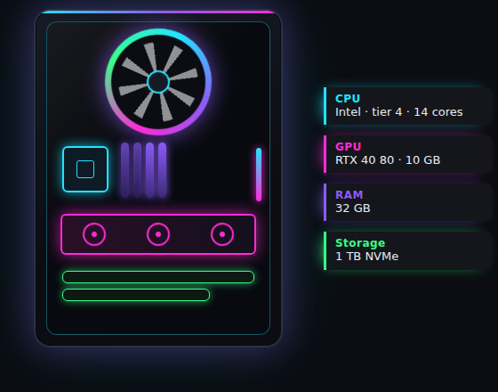

# TechValue AI: Computer Price Prediction

Machine learning web app that predicts the price of a **laptop or desktop** from its hardware specifications. Built with **scikit-learn** and **Streamlit**, and trained on the Kaggle *Computer Prices 2025* dataset.

**Live app:** _add your Streamlit link here_



## Features

- Interactive PC configurator: CPU, GPU, memory, storage, display and more (all 30 model inputs)
- One-click price estimate from a trained neural network
- Charts: price gauge, comparison with real dataset averages, price distribution, spec percentiles
- Model performance card (MAE, RMSE, R²) and algorithm comparison
- Optional currency view with live exchange rates or a manual rate
- Sample builds, reset button, input validation and safe handling of unknown values

## Dataset

[Computer Prices 2025](https://www.kaggle.com/competitions/computer-prices-2025) (Kaggle)

| | |
|---|---|
| Labelled rows | 100,000 |
| Columns | 34 (ID, 30 features, `price`) |
| Missing values / duplicates | none |
| Target | `price` (continuous, so this is a regression task) |
| Currency | not stated in the files, so prices are shown as "price units" |

`ID`, `model` (~99k unique names) and `cpu_model` (~27k unique codes) are not used as inputs. The raw data is not included in this repo; check the competition rules before redistributing it.

## Models and results

Five algorithms were compared with **10-fold cross-validation on all 100,000 rows**:

| Rank | Model | Mean RMSE | Mean MAE | Mean R² |
|---|---|---|---|---|
| 1 | **Neural Network (MLP)** | **217.64** | 141.33 | 0.8587 |
| 2 | Bayesian Ridge | 220.71 | 144.50 | 0.85 |
| 3 | Ridge | 220.71 | 144.51 | 0.85 |
| 4 | Elastic Net | 221.01 | 144.64 | 0.85 |
| 5 | SVR (RBF) | 231.63 | 154.15 | 0.84 |

SVR was trained on a random 10,000-row subset per fold (validated on the full fold) because full-size SVR is too slow. The full analysis, charts and explanations are in `TechValue_AI.ipynb` and `TechValue_AI.pdf`.

## Quick start

```bash
git clone https://github.com/<your-username>/computer-price-prediction-ml.git
cd computer-price-prediction-ml
pip install -r requirements.txt
streamlit run app.py
```

`scikit-learn` is pinned to 1.8.0, the version that created `model_artifacts/model.joblib`.

To retrain, open `TechValue_AI.ipynb` in Google Colab, upload `computer_prices_all.csv`, run all cells, and copy the new `model_artifacts/` folder into the project.

## Deploy on Streamlit Community Cloud

1. Push this project to GitHub (never commit credentials).
2. Go to [share.streamlit.io](https://share.streamlit.io) and click **Create app**.
3. Select the repository and set the main file path to `app.py`.
4. Deploy, then paste the live URL at the top of this README.

## Project structure

```
├── app.py                  # Streamlit app (main file)
├── core.py                 # model loading, validation, charts, currency helpers
├── TechValue_AI.ipynb      # full training and evaluation notebook
├── TechValue_AI.pdf        # PDF export of the notebook
├── requirements.txt
├── submission.csv          # predictions for the Kaggle test file
├── model_artifacts/
│   ├── model.joblib        # saved preprocessing + model pipeline
│   └── metadata.json       # categories, ranges, dataset statistics, metrics
├── assets/
└── .streamlit/config.toml  # dark theme
```

## Limitations

- The dataset does not state a currency; the app's currency view relies on an assumption you choose.
- The data looks machine-generated (for example Apple-brand computers running Windows), so results reflect this dataset, not the real market.
- Accuracy drops for very expensive computers: the 78 priced above 4,500 are under-predicted by about 3,900 on average.
- No hyper-parameter tuning was done, and the neural network beats Ridge by only about 1.4%.
- Estimates are not guaranteed market prices.


## Credits

Data: Kaggle *Computer Prices 2025*. Built for educational purposes.
